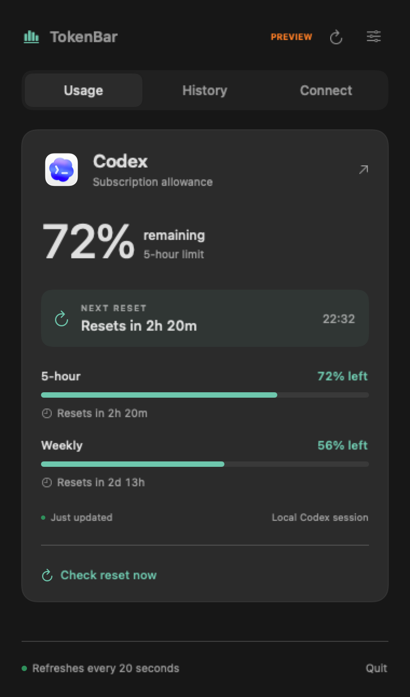

# TokenBar

A native macOS menu bar app for tracking AI usage and quota resets.



*Screenshot uses sample data.*

## Features

- Remaining Codex and Claude quota, with reset countdowns.
- Show all available providers or choose one to save menu bar space.
- Quota checks every 20 seconds, with optional low-quota and confirmed-reset notifications.
- Local usage history, token totals, and a manual **Check reset now** button.
- Optional Ollama, LM Studio, and Gemini usage capture.

## Download for Mac

[Download TokenBar for Mac](https://github.com/ajayvenugopal/After-Hours/releases/download/tokenbar-v0.1.0/TokenBar-0.1.0-universal.dmg) · macOS 13+ · Apple silicon and Intel

Open the DMG, drag **TokenBar** into **Applications**, then launch it. The app appears in the menu bar.

This preview is ad-hoc signed and **not notarized**. If macOS blocks it, try opening the app once, then go to **System Settings → Privacy & Security → Open Anyway**. Only override this for a download you trust. Provider connections use the same setup below.

## Build and run

Requires **macOS 13+**, **Xcode Command Line Tools**, and **Swift 5.9+**. There are no third-party Swift dependencies. Run from this project’s directory:

```sh
bash scripts/build.sh
open dist/TokenBar.app
```

TokenBar appears in the menu bar. Click its icon to view usage; open settings to choose providers, display style, notifications, or launch at login. Copy `dist/TokenBar.app` to `/Applications` to keep it installed.

To produce the universal download, run `bash scripts/package-dmg.sh`. Build outputs stay in `dist/`. Developer ID signing and notarization are required for a release that opens without a Gatekeeper override; signing credentials are not included.

## Connect your accounts

**Codex:** Sign in using the installed Codex app or CLI. TokenBar reads live account limits through its local app server. If that connection fails, it labels local session data as a fallback.

**Claude Code:** Install the bridge with Python 3:

```sh
python3 scripts/install-claude-bridge.py
```

Restart Claude Code and send a prompt. Claude appears when it reports quota data. To restore your previous status line, run the same command with `--uninstall`.

For local models and Gemini, see the [integration guide](docs/INTEGRATIONS.md).

## Understanding usage

Quota percentages represent the provider’s allowance, rather than an exact count of subscription tokens remaining. Reset alerts require fresh evidence of a reset; an expired countdown alone is not confirmation. Codex supports live account checks; Claude checks rely on its latest status-line data.

History and capture helpers store usage metadata locally. They do not save prompts, responses, or API keys. Costs are hidden when no cost data is available. See [data sources and limitations](docs/DATA.md) for details.

## Development

```sh
swift test
python3 -m unittest discover -s Tests/BridgeTests -v
```

See [contributing](CONTRIBUTING.md) for project layout and reporting issues.

## License

[MIT](LICENSE) · Afterhours contributors.
